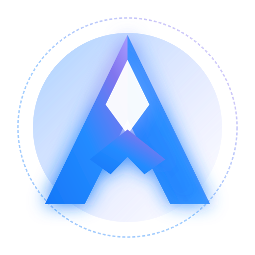

# AUREON OS

<p align="center">
  
</p>

<p align="center">
  <strong>Dream • Create • Explore</strong><br>
  <em>Premium Cross-Platform Desktop Operating System & Independent Linux Distribution</em>
</p>

---

## ✨ Features

- **💎 Translucent Glass Aesthetic:** Built strictly to the light-theme reference specifications (`#EEF3FF` base, `#1677F8` blue, `#A99BFF` lavender) with frosted glass panels and ambient shadows.
- **🖥️ Complete Desktop Shell:** Integrated top menu bar, centerpiece logo with sun halo arc, desktop shortcuts, welcome widget, and floating smart dock.
- **🪟 Real Window Manager:** Draggable, resizable, minimizable, maximizable windows with live dock indicators and window management.
- **📱 10+ Native Applications:**
  - **AUREON Files:** Dual-pane browser, breadcrumbs, search, context menu, and persistent filesystem.
  - **AUREON Settings:** Full 11-category system settings with live theme & wallpaper switching.
  - **AUREON System Monitor:** Animated CPU, RAM, GPU gauges with live telemetry wave graphs and process manager.
  - **AUREON Store:** Modern marketplace with search, category filtering, and app installation.
  - **AUREON AI Assistant:** On-device intelligent assistant with animated pulsing orb and suggested actions.
  - **AUREON Terminal, Browser, Calendar, Notes, Photos, Music, Videos, Calculator.**
- **⚡ Background System Services:** Real metrics daemon on `localhost:8765`, local AI bridge, and security permission manager.
- **🚀 One-Command Launch:** Instant launch via `python3 run.py`.

---

## 🚀 Quick Start (Instant Live Run)

To start the entire AUREON OS suite (background services + desktop shell):

```bash
# Clone the repository
git clone https://github.com/sratanshu007/AUREON-OS.git
cd AUREON-OS

# Start AUREON OS
python3 run.py
```

This will automatically:
1. Start the system telemetry daemon on `http://127.0.0.1:8765`.
2. Launch the local web server on port `8080`.
3. Open the AUREON OS Desktop in your default browser or desktop window!

---

## 🛠️ Native C++ / Qt6 Compilation

### macOS:
```bash
./scripts/build_macos.sh
```

### Linux:
```bash
./scripts/build_linux.sh
```

---

## 📂 Project Structure

```
AUREON OS/
├── apps/               # Desktop Shell, Files, Settings, Monitor, Store, AI, etc.
├── assets/             # Wallpapers (mountain sunrise), SVG logos, app icons
├── core/               # Window manager, search engine, theme tokens, workspace
├── services/           # System telemetry, AI service, security, device sync
├── platform/           # macOS (CoreWLAN, IOKit) & Linux (Wayland, D-Bus)
├── distribution/       # Boot animation, login screen, Linux installer, GRUB theme
├── packaging/          # Debian, RPM, Flatpak, and macOS Info.plist
├── tests/              # Unit & integration test suite
├── documentation/      # Architecture, Installation, API Reference
└── run.py              # Master launcher script
```

---

*Copyright © 2026 AUREON OS Project. Dream • Create • Explore.*
